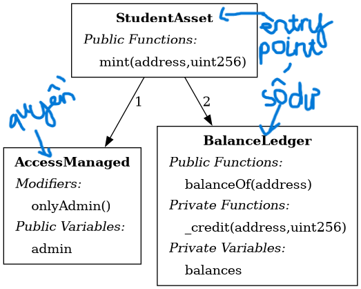
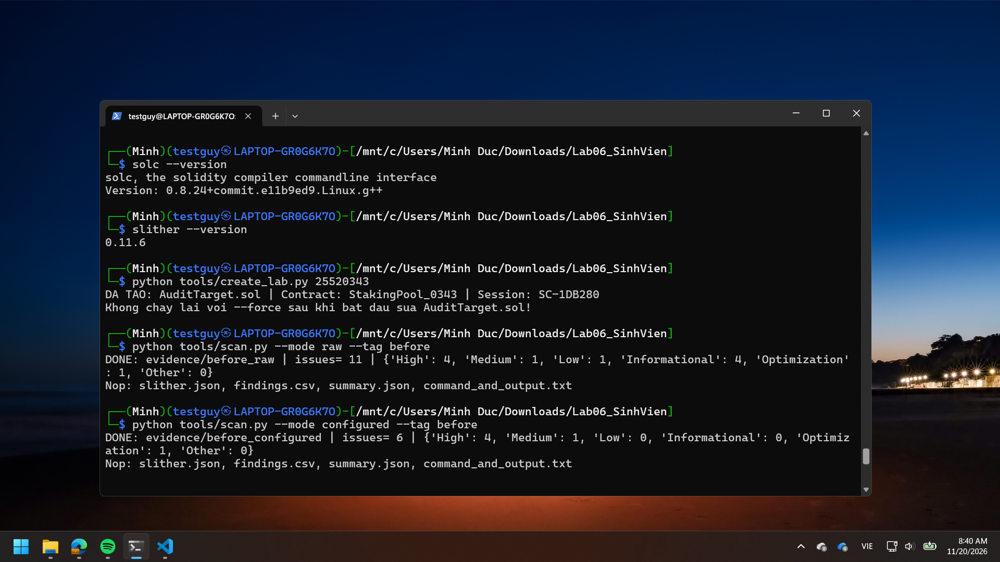
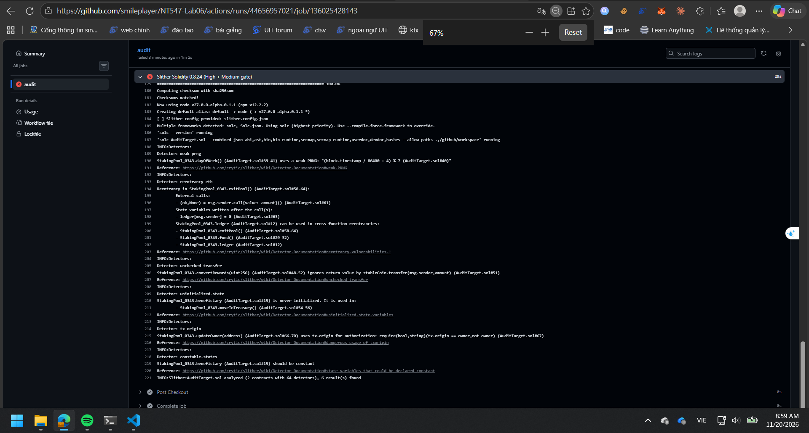
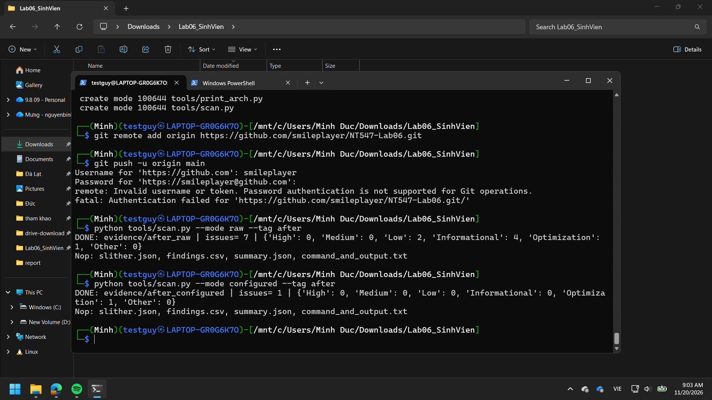
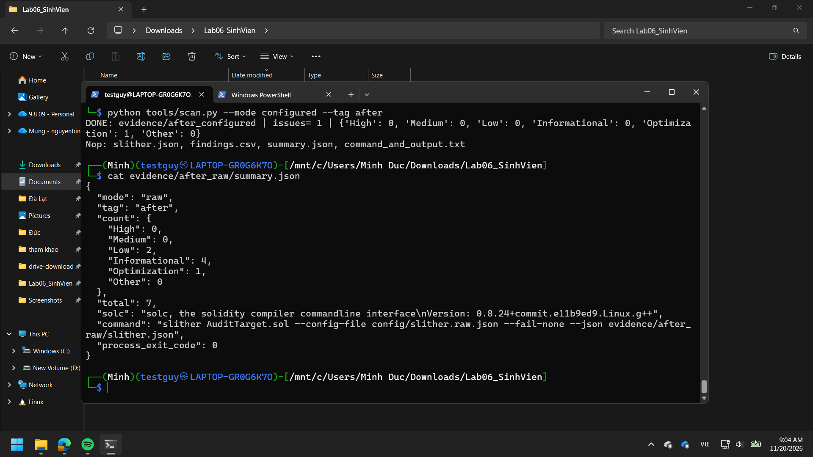
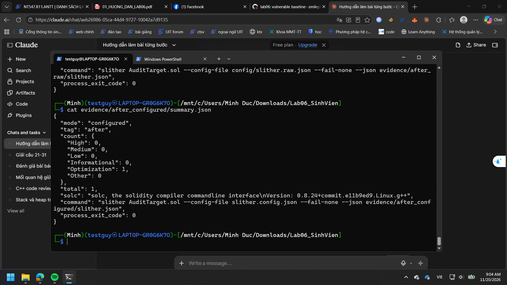
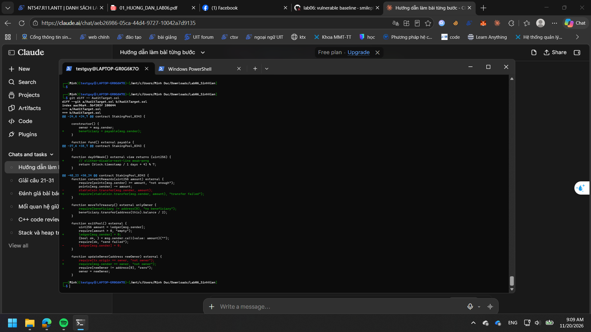
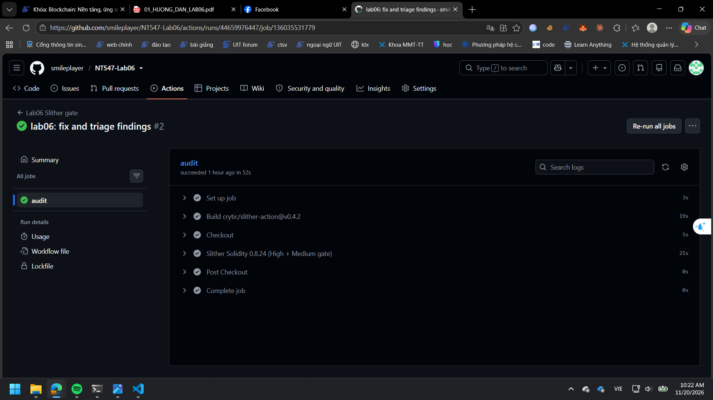
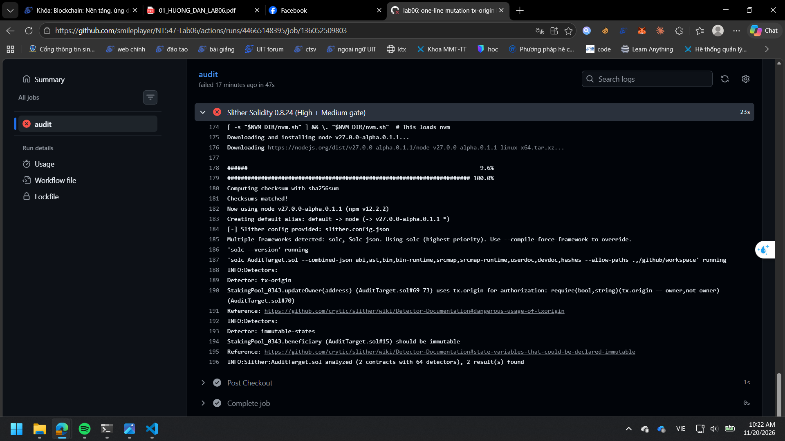
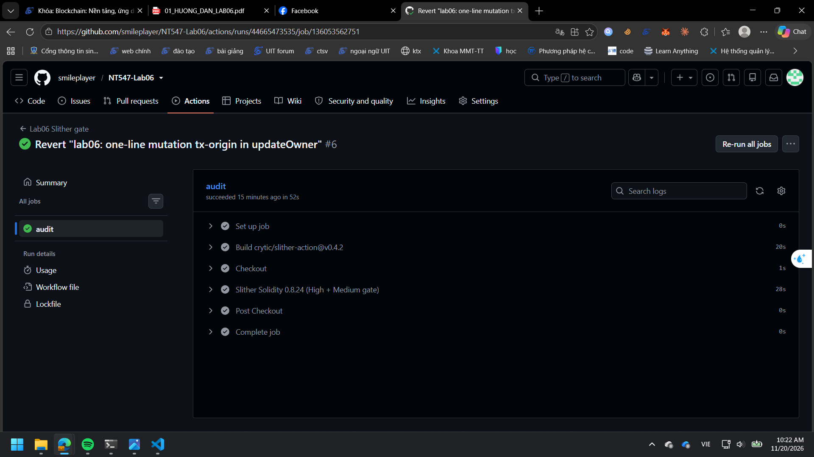

# NT547 - LAB 06 - BÁO CÁO (TỰ ĐIỀN)

**MSSV:** 25520343  | **Họ tên:** Tạ Minh Đức | **Lớp:** ATTT2025.1
**Session code tự sinh:** SC-1DB280 | **Tên contract:** StakingPool_0343
**Solidity / Slither:** 0.8.24 / 0.11.6 | **Ngày hoàn thành:** 20/11/2026
**URL GitHub repository:** https://github.com/smileplayer/NT547-Lab06

## 1. Static scan (2,0 điểm)

- Lệnh raw: `python tools/scan.py --mode raw --tag before`
- Số lượng finding raw từ `evidence/before_raw/summary.json`:
  - High: 4; Medium: 1; Low: 1; Informational: 4; Optimization: 1
- Chạy configured: `python tools/scan.py --mode configured --tag before`
- So sánh raw/configured: Configured có: High 4; Medium 1; Low 0; Informational 0; Optimization 1 (tổng 6). Nhận xét: config chỉ lọc bớt Low/Informational (timestamp, low-level-calls, naming-convention), còn 4 High + 1 Medium vẫn giữ nguyên, nên đổi config không làm biến mất lỗi nghiêm trọng.
- 3 detector **khác tên**: `reentrancy-eth`, `tx-origin`, `unchecked-transfer`
  (ngoài ra raw còn có: weak-prng, uninitialized-state, timestamp, low-level-calls, naming-convention, constable-states, tổng cộng 9 detector khác nhau)

| ID finding | Detector | Impact | Confidence | Source (file:dòng) | Luồng dữ liệu: đầu vào -> thao tác -> tác hại |
|---|---|---|---|---|---|
| F01 | reentrancy-eth | High | Medium | AuditTarget.sol: `exitPool()` dòng 58-64 (external call dòng 61, ghi state dòng 63) | Contract độc hại gọi `exitPool()` -> ETH được gửi đi bằng `.call` ở dòng 61 trước khi `ledger[msg.sender]` về 0 ở dòng 63 -> hàm fallback gọi lại `exitPool()` nhiều lần và rút vượt số dư của mình |
| F02 | tx-origin | Medium | Medium | AuditTarget.sol: `updateOwner(address)` dòng 66-70 (dòng 67) | Owner bị dụ gọi một contract trung gian -> `require(tx.origin == owner)` vẫn thỏa vì `tx.origin` là owner thật -> contract trung gian gọi `updateOwner` và chiếm quyền owner |
| F03 | unchecked-transfer | High | Medium | AuditTarget.sol: `convertRewards(uint256)` dòng 48-52 (dòng 51) | Người dùng gọi `convertRewards` -> `stableCoin.transfer` có thể trả `false` mà giao dịch không revert, hàm không kiểm tra -> hệ thống coi như đã trả thưởng nhưng người dùng không nhận được token |

## 2. Triage và sửa lỗi (2,5 điểm)

Đọc toàn bộ AuditTarget.sol: nhận diện **4 mẫu lỗi thật + 2 đoạn cần đánh giá ngữ cảnh**.
Cả 6 mẫu đều được Slither báo; không có mẫu "Manual review / Not reported".

| Detector + vị trí | TP / FP / Chưa kết luận | Bằng chứng kiểm soát/khả năng khai thác | Biện pháp (Fix / Accept có lý do) | Sau sửa |
|---|---|---|---|---|
| reentrancy-eth (High) – `exitPool()` dòng 58-64 | TP | Hàm `external`, không giới hạn quyền; `.call` ở dòng 61 chạy trước `ledger[msg.sender]=0` ở dòng 63 nên contract độc hại gọi lại được | Fix: Checks-Effects-Interactions, đưa `ledger[msg.sender]=0` lên trước `.call` | Hết ở cả raw và configured |
| unchecked-transfer (High) – `convertRewards()` dòng 48-52 | TP | Hàm `external`, `points` bị trừ ở dòng 50 nhưng kết quả `transfer` ở dòng 51 không được kiểm tra | Fix: `require(stableCoin.transfer(msg.sender, amount), "transfer failed")` | Hết ở cả raw và configured |
| uninitialized-state (High) – `beneficiary` dòng 15, dùng trong `moveToTreasury()` dòng 54-56 | TP | Không có dòng nào ghi `beneficiary` nên luôn là `address(0)`, `transfer` gửi ETH vào địa chỉ 0 và mất vĩnh viễn | Fix: gán `beneficiary = payable(msg.sender)` trong constructor, thêm `require(beneficiary != address(0))` trong `moveToTreasury` | Hết ở cả raw và configured |
| tx-origin (Medium) – `updateOwner()` dòng 66-70 | TP | Quyền kiểm tra bằng `tx.origin` (dòng 67) nên bị lợi dụng qua contract trung gian | Fix: đổi thành `require(msg.sender == owner, "not owner")` | Hết ở cả raw và configured |
| weak-prng (High) – `dayOfWeek()` dòng 39-41 | Accepted (không khai thác được) | Hàm `view`, không ghi state, không chuyển tiền, không cấp quyền; chỉ trả về thứ trong tuần để hiển thị | Accept: `// slither-disable-next-line weak-prng` đúng dòng 40, lý do ở dưới | Không còn báo ở cả hai chế độ |
| timestamp (Low) – `releaseTenth()` dòng 72-77 | Accepted | Hàm có `onlyOwner`; cooldown 1 ngày nên miner chỉ lệch vài giây, không đủ ảnh hưởng điều kiện `block.timestamp >= cooldownEnd` | Accept: không đổi code, mức Low không chặn CI ở ngưỡng Medium | Còn ở raw (Low), configured lọc bỏ |

- Kịch bản khai thác TP (reentrancy): kẻ tấn công deploy contract có `fallback` gọi lại `exitPool()` -> gọi `fund()` gửi một ít ETH rồi gọi `exitPool()` -> `.call` gửi ETH ở dòng 61 trước khi `ledger` về 0, `fallback` gọi `exitPool()` lần nữa với `ledger` vẫn còn giá trị cũ -> lặp lại cho tới khi pool cạn ETH của người dùng khác.
- Finding severity cao nhưng risk thực tế thấp: `weak-prng` được Slither xếp High, nhưng `dayOfWeek()` là hàm `view` chỉ để hiển thị thứ trong tuần. Không có tiền hay quyền nào phụ thuộc kết quả, và miner chỉ lệch được timestamp vài giây, không đủ để chuyển sang ngày khác một cách có lợi. Vì vậy risk thực tế thấp hơn nhiều so với nhãn High.
- Bằng chứng `git diff`, scan before/after:

| Chế độ | High | Medium | Low | Informational | Optimization | Tổng |
|---|---|---|---|---|---|---|
| raw before | 4 | 1 | 1 | 4 | 1 | 11 |
| raw after | 0 | 0 | 2 | 4 | 1 | 7 |
| configured before | 4 | 1 | 0 | 0 | 1 | 6 |
| configured after | 0 | 0 | 0 | 0 | 1 | 1 |

  Cảnh báo còn lại sau sửa (đều không phải High/Medium) và lý do chấp nhận:
  - `events-access` (Low): `updateOwner()` đổi `owner` nhưng không phát event, nên khó theo dõi off-chain. Không gây mất tiền hay chiếm quyền, quyền gọi đã giới hạn bằng `msg.sender == owner`. Có thể bổ sung event sau; trong phạm vi bài chấp nhận.
  - `timestamp` (Low): đã phân tích ở bảng trên.
  - `low-level-calls` (Informational, 3 chỗ: `ownerWithdraw`, `exitPool`, `releaseTenth`): cả ba đều kiểm tra `require(ok, ...)`, và `exitPool` đã theo thứ tự Checks-Effects-Interactions, nên chấp nhận.
  - `naming-convention` (Informational): tên contract `StakingPool_0343` có hậu tố MSSV do bài sinh tự động, chỉ là quy ước đặt tên.
  - `immutable-states` (Optimization): `beneficiary` chỉ được gán trong constructor nên có thể khai báo `immutable` để tiết kiệm gas; không phải lỗ hổng bảo mật.
- Lý do `slither-disable-next-line`: một chỗ duy nhất, detector `weak-prng`, đặt ngay trước biểu thức bị báo trong `dayOfWeek()` (dòng 40 ở baseline; ở bản đã sửa comment nằm dòng 41, biểu thức dòng 42). Kiểm soát bù trừ: hàm `view`, không ghi state, không chuyển ETH/token, kết quả không được dùng làm nguồn ngẫu nhiên cho quyền hoặc tiền.

## 3. Kiến trúc / Inheritance (1,5 điểm)

- Lệnh printer đã chạy: `python tools/print_arch.py` (sinh `human_summary.txt`), sau đó chạy tay `slither contracts/ArchitectureDemo.sol --print inheritance-graph --config-file config/slither.raw.json --fail-none` vì script không tìm thấy file `.dot` (Slither ghi ra `contracts/ArchitectureDemo.sol.inheritance-graph.dot`); file này được copy vào `evidence/architecture/` và render bằng `dot -Tpng`.
- Ảnh `evidence/architecture/inheritance_annotated.png` (có đánh dấu node; bản gốc `inheritance.png`), kèm `.dot` và `human_summary.txt`: 
- Access control nằm ở `AccessManaged` (biến `admin`, modifier `onlyAdmin`); logic số dư nằm ở `BalanceLedger` (mapping `balances`, hàm `_credit`); contract triển khai nằm ở `StudentAsset` (kế thừa cả hai, là contract được gọi từ bên ngoài).
- Giải thích 3-5 câu điểm audit cần bắt đầu: Phần security-critical chia ở hai contract cha: `AccessManaged` quyết định ai được phép làm gì (`admin`, `onlyAdmin`), còn `BalanceLedger` giữ state tiền (`balances`) và chỉ cho `_credit` ghi nội bộ. Entrypoint thật sự là `StudentAsset.mint`, vì đây là hàm `external` duy nhất thay đổi state, và nó nối hai phần: `onlyAdmin` chặn người lạ rồi `_credit` cộng số dư. Nên bắt đầu audit từ `mint`, sau đó lần ngược lên `onlyAdmin` trong `AccessManaged` (kiểm tra `admin` được gán đúng trong constructor và không đổi được) và `_credit` trong `BalanceLedger` (kiểm tra không có đường nào khác ghi vào `balances`). Làm vậy vì lỗ hổng thường nằm ở chỗ nối giữa các contract: nếu `mint` thiếu `onlyAdmin` hay `to` không được kiểm tra, bất kỳ ai cũng tạo được số dư.

## 4. Red -> Green CI (2,5 điểm)

| Phase | Commit (full/short SHA) | Run URL | Kết quả | Detector khiến RED / lý do GREEN |
|---|---|---|---|---|
| Baseline vulnerable | b7ac78c68c6943c1dfe10f9f111f287b485bf3eb / b7ac78c | https://github.com/smileplayer/NT547-Lab06/actions/runs/44656957021 | RED | 4 High + 1 Medium: `weak-prng`, `reentrancy-eth`, `unchecked-transfer`, `uninitialized-state` (High) và `tx-origin` (Medium). Log: `6 result(s) found` (cả `constable-states` mức Optimization) |
| Patched | dfca9b4865ed4850cd95a81cc080df9785e5ee11 / dfca9b4 | https://github.com/smileplayer/NT547-Lab06/actions/runs/44659976447 | GREEN | Sửa 4 TP (CEI ở `exitPool`, `require` kết quả `transfer`, khởi tạo `beneficiary`, `msg.sender` thay `tx.origin`) và suppression đúng dòng cho `weak-prng` ở `dayOfWeek`; còn lại chỉ Low/Informational/Optimization, dưới ngưỡng `fail-on: medium` |

- So sánh local `--fail-none` (thu thập findings) với CI `fail-on: medium`: Ở local em dùng `--fail-none` nên scan luôn có exit code 0 (`process_exit_code: 0`) dù contract còn 4 High + 1 Medium; mục đích chỉ là lưu `slither.json/findings.csv` làm bằng chứng, không có nghĩa contract an toàn. CI dùng `fail-on: medium` nên cùng bản baseline đó làm job `audit` fail (RED), còn bản đã sửa không còn High/Medium nên GREEN.
- `exclude_low/informational` thay đổi kết quả hiển thị ra sao: Config `slither.config.json` chỉ lọc bớt Low/Informational. Trước khi sửa, raw có 11 finding (4 High, 1 Medium, 1 Low, 4 Informational, 1 Optimization) còn configured chỉ còn 6 (4 High, 1 Medium, 0 Low, 0 Informational, 1 Optimization). 4 High và 1 Medium vẫn giữ nguyên ở cả hai chế độ, tức đổi config không làm biến mất lỗi nghiêm trọng. Sau khi sửa, raw còn 7 (0/0/2/4/1) và configured còn 1 (`immutable-states`).

## 5. Mutation RED -> GREEN (1,5 điểm)

- Mutation một dòng: `require(msg.sender == owner, "not owner")` -> `require(tx.origin == owner, "not owner")`.
  - Lần 1 trong `modifier onlyOwner` (dòng 21, commit `8f9986a`): CI vẫn GREEN. Scan local bản mutation (`evidence/mutation_raw`, `evidence/mutation_configured`) không có finding `tx-origin`, tức Slither 0.11.6 không báo `tx.origin` khi nó nằm trong modifier (false negative của công cụ).
  - Lần 2 trong `updateOwner` (dòng 70 ở bản đã sửa, commit `a5a3e6e`): cùng kiểu thay đổi, đúng một dòng bảo vệ quyền, tại vị trí baseline từng bị báo `tx-origin`. Scan local bản mutation này (`evidence/mutation2_configured/`) báo `tx-origin` (Medium) + `immutable-states`, khớp với CI.
- Detector kỳ vọng: `tx-origin` (mức Medium); xác nhận của em từ CI: log step "Slither Solidity 0.8.24 (High + Medium gate)" của run 44665148395 ghi `Detector: tx-origin` - `StakingPool_0343.updateOwner(address) (AuditTarget.sol#69-73) uses tx.origin for authorization: require(bool,string)(tx.origin == owner,not owner) (AuditTarget.sol#70)`, kèm `immutable-states` (Optimization), tổng `2 result(s) found`. Vì `tx-origin` là Medium nên gate `fail-on: medium` làm job `audit` fail (ảnh `evidence/screenshots/08_ci_red_mutation_a5a3e6e.png`).

| Phase | Commit SHA | Run URL | Kết quả |
|---|---|---|---|
| Mutation (`updateOwner`) | a5a3e6e34923f184a7d2e9b02df6083cd6833552 | https://github.com/smileplayer/NT547-Lab06/actions/runs/44665148395 | RED |
| Revert mutation | 7590e3337bdaa6c28ae296c40619329c4897c60c | https://github.com/smileplayer/NT547-Lab06/actions/runs/44665473535 | GREEN |

- Bằng chứng phụ (mutation lần 1, không dùng trong bảng chính): commit `8f9986a` (mutation trong `modifier onlyOwner`, CI GREEN) và `57048ac` (revert của nó, GREEN), kèm `git show 8f9986a`, `evidence/mutation_raw/`, `evidence/mutation_configured/`.
- Giải thích sự thay đổi về nguồn định danh/authorization: `msg.sender` là địa chỉ gọi trực tiếp hàm nên chỉ owner thật gọi mới qua được kiểm tra. `tx.origin` là địa chỉ gốc khởi tạo giao dịch, nên nếu owner bị dụ gọi một contract trung gian, contract đó gọi `updateOwner` thì `tx.origin == owner` vẫn đúng và kẻ tấn công đổi được `owner`. Vì vậy kiểm tra quyền phải dựa trên `msg.sender`.

## 6. Bằng chứng, tự kiểm

- [x] `AuditTarget.sol`, `lab_identity.json`
- [x] `evidence/before_raw/` và `evidence/before_configured/`
- [x] `evidence/after_raw/` và `evidence/after_configured/`
- [x] `evidence/architecture/`
- [x] 04 URL Actions run RED/GREEN/RED/GREEN + 04 commit SHA
- [x] Link repo và ảnh màn hình có terminal / URL / commit SHA; không cắt mất ngữ cảnh
- [x] Các finding được triage, không chép lại mô tả detector thay cho suy luận
- [x] Tuyệt đối không có seed phrase, private key, credentials

### Ảnh minh chứng (`evidence/screenshots/`)

| # | Nội dung | Ảnh |
|---|---|---|
| 1 | `solc 0.8.24`, `slither 0.11.6`, `create_lab.py 25520343` (SC-1DB280), scan raw/configured BEFORE (11 / 6 finding) |  |
| 2 | CI RED baseline, run 44656957021 (b7ac78c): 6 result(s) found, có `reentrancy-eth`, `unchecked-transfer`, `uninitialized-state`, `weak-prng`, `tx-origin` |  |
| 3 | `git remote add origin` + scan raw/configured AFTER (7 / 1 finding) |  |
| 4 | `evidence/after_raw/summary.json` |  |
| 5 | `evidence/after_configured/summary.json` |  |
| 6 | `git diff -- AuditTarget.sol` (4 bản sửa + 1 suppression) |  |
| 7 | CI GREEN patched, run 44659976447 (dfca9b4) |  |
| 8 | CI RED mutation, run 44665148395 (a5a3e6e): `Detector: tx-origin` tại `AuditTarget.sol#70` |  |
| 9 | CI GREEN revert, run 44665473535 (7590e33) |  |

**Nhận xét cuối cùng (5-7 câu):** Slither giúp em phát hiện rất nhanh 4 lỗi High và 1 lỗi Medium ngay ở bản baseline, và khi gắn vào GitHub Actions với `fail-on: medium` thì CI chặn được bản có lỗi (RED) và chỉ cho qua khi đã sửa (GREEN). Tuy vậy không thể tin tuyệt đối vào nhãn severity của công cụ: `weak-prng` bị xếp High nhưng `dayOfWeek()` chỉ là hàm `view` để hiển thị nên em chấp nhận bằng suppression đúng một dòng có lý do. Ngược lại công cụ cũng có thể bỏ sót: khi em đổi `msg.sender` thành `tx.origin` trong `modifier onlyOwner`, Slither 0.11.6 không báo gì và CI vẫn GREEN, chỉ khi mutation nằm trong thân hàm `updateOwner` thì mới RED. Điều đó cho thấy quality gate chỉ có giá trị khi đi kèm triage và đọc code thủ công, đặc biệt ở các chỗ kiểm soát quyền. Cấu hình `exclude_low/informational` chỉ giảm nhiễu hiển thị chứ không làm mất lỗi nghiêm trọng, nên vẫn cần xem bản raw. Cuối cùng, việc revert bằng commit mới thay vì sửa lịch sử giúp giữ lại chuỗi bằng chứng RED -> GREEN -> RED -> GREEN rõ ràng cho người review.
